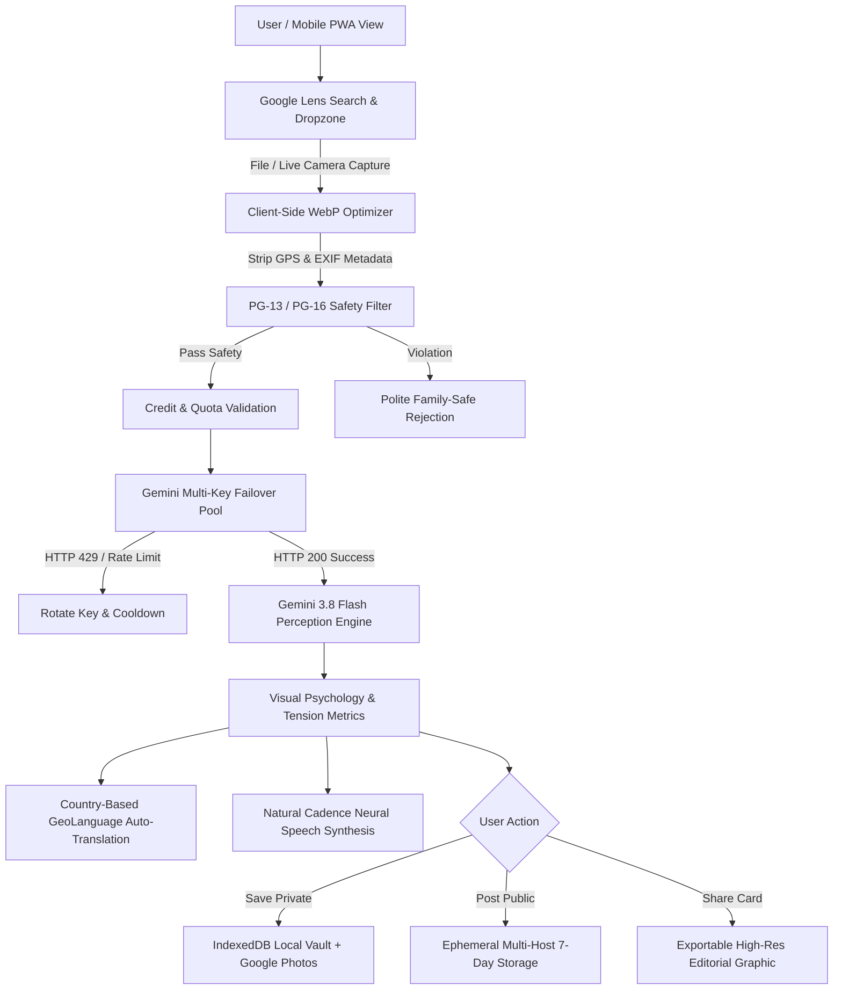

<div align="center">

# 🔮 PsychLens (EmotiSight)
### Visual Psychology, Micro-Expression & Emotional Intelligence Engine

[](LICENSE)
[](https://techfiyr.com)
[](https://react.dev/)
[](https://vitejs.dev/)
[](https://ai.google.dev/)
[](https://www.revenuecat.com/)
[](public/manifest.json)

**A serene, human-centric visual perception engine that decodes subconscious emotions, facial micro-expressions, atmospheric tension indices, and color psychology from photos and live camera streams.**

[Explore Web App](https://techfiyr.com) • [Commercial Licensing](https://techfiyr.com) • [Report Issue](https://github.com/swahid/psychlens/issues)

</div>

---

## 📖 Table of Contents
1. [Executive Overview & Purpose](#-executive-overview--purpose)
2. [Key Architecture & Core Capabilities](#-key-architecture--core-capabilities)
3. [System Architecture Diagram](#-system-architecture-diagram)
4. [Technology Stack](#-technology-stack)
5. [Monetization & Credit Economy](#-monetization--credit-economy-revenuecat-powered)
6. [Privacy, Safety & Regulatory Safe Harbor](#-privacy-safety--regulatory-safe-harbor)
7. [Installation & Build Process](#-installation--build-process)
8. [Admin Operations Dashboard](#-admin-operations-dashboard)
9. [Ethical Safe Harbor & AI Disclaimer](#-ethical-safe-harbor--ai-disclaimer)
10. [Licensing & Commercial Restrictions](#-licensing--commercial-restrictions)

---

## 🌟 Executive Overview & Purpose

Every day, people view portraits, street photographs, confession videos, and candid moments without recognizing the subtle, unspoken psychological undercurrents:
- **What is the real emotion beneath a guarded smile?**
- **How does room lighting and chromatic temperature manipulate the viewer’s feelings?**
- **Where is the subject’s gaze wandering, and what does their micro-posture convey?**

**PsychLens** functions like a mindful magnifying glass for visual human emotion. Using Google’s **Gemini 3.8 Flash Multimodal API**, it analyzes visual composition in real time, translating complex behavioral patterns into clear, empathetic, and relatable psychological insights.

Designed with an editorial, **Google Images / Google Lens-inspired aesthetic**, PsychLens intentionally departs from cliché dark cyberpunk interfaces in favor of a clean, serene, human-centric light theme.

---

## ⚡ Key Architecture & Core Capabilities

### 1. Minimalist Google Images / Google Lens Interface
- **Zero-Intimidation Load**: The app loads instantly into a peaceful search-and-drop pill without requesting camera permissions or opening heavy dark viewports.
- **Opt-In Live Camera**: Users click the `📷` camera icon to open a responsive viewfinder with a rule-of-thirds grid, flip controls, 3s countdown timer, and an instant `✕ Close` toggle.
- **Drag-and-Drop Dropzone & URL Input**: Drag any photo directly onto the page, paste an image URL, or click curated psychological moment cards (`Solitude Commute`, `Vulnerable Gaze`, `Street Confession`, `Warm Contemplation`).

### 2. Multi-Key Gemini API Pool with HTTP 429 Failover
- Bundles a prioritized pool of Gemini API keys.
- **Dynamic Rate-Limit Failover**: Automatically intercepts **HTTP 429 ("Too Many Requests")** or **RESOURCE_EXHAUSTED** limits, places the affected key into cooldown, and fails over to the next healthy key in milliseconds without breaking the user session.
- **BYOK (Bring Your Own Key)**: Users can connect their personal Google Gemini API key to receive an instant **+500 credits bonus**.

### 3. Natural Human Voice Cadence (No Robotic Monotone)
- Calibrated Web Speech synthesis running at **0.92 rate** and **1.0 pitch** to mirror the thoughtful, contemplative speaking cadence of a human mentor.
- Neural voice selection automatically selects the most organic human voice available on the device (`Google`, `Natural`, `Enhanced`, `Samantha`, `Karen`, `Daniel`).
- Gemini prompts are engineered to generate empathetic, warm conversational phrasing rather than cold psychiatric jargon.

### 4. Country-Based Auto-Detection & Real-Time Multilingual Engine
- Automatically detects the visitor’s country and native language using browser timezone, locales, and IP geo-intelligence.
- Supports **15 natural languages** with national flags:
  - 🇧🇩 Bengali • 🇮🇳 Hindi • 🇪🇸 Spanish • 🇫🇷 French • 🇩🇪 German • 🇯🇵 Japanese • 🇸🇦 Arabic • 🇧🇷 Portuguese • 🇮🇹 Italian • 🇰🇷 Korean • 🇨🇳 Chinese • 🇹🇷 Turkish • 🇷🇺 Russian • 🇳🇱 Dutch • 🇺🇸 English
- Auto-translates reports into the visitor's native language and switches the voice synthesizer to match.

### 5. Multi-Host Ephemeral Public Storage (Zero Server Cost)
- Cascading image hosting pipeline: **ImgBB (7-Day TTL)** &rarr; **Litterbox/Catbox (72-Hour Auto-Delete)** &rarr; **FreeImage.host**.
- Free uploads automatically delete in **7 days or less**.
- Paid subscribers automatically sync master copies to their private **Google Photos** album (`photoslibrary.appendonly` minimal scope).

---

## 📐 System Architecture Diagram



---

## 🛠️ Technology Stack

| Layer | Technologies Used |
| :--- | :--- |
| **Frontend Framework** | React 19, Vite 8, Modern Vanilla CSS (Light Theme Design System) |
| **Icons & Visuals** | Lucide React, Custom SVG Aperture-Mind Logo, Canvas Confetti |
| **AI Perception Models** | Google Gemini 3.8 Flash Multimodal (`gemini-3.8-flash`) |
| **Voice & Speech** | Web Speech Synthesis API (Neural / Natural voice filtering) |
| **Image Processing** | HTML5 Canvas (Client-side WebP compression & EXIF GPS stripping) |
| **Storage & Persistence** | IndexedDB (`idb`), Google Photos REST API (`photoslibrary.appendonly`) |
| **Public Image Hosting** | Ephemeral multi-host fallback (ImgBB 7d &rarr; Litterbox 72h) |
| **Monetization & Billing** | RevenueCat Web SDK, Google Play Billing & Apple StoreKit ready |
| **Analytics & Telemetry** | Google Analytics 4 (GA4) with custom emotional event tracking |
| **Mobile Architecture** | Android PWA Manifest, Mobile Touch Viewport, Standalone Mode |

---

## 💳 Monetization & Credit Economy (RevenueCat Powered)

PsychLens implements a sustainable, transparent freemium credit model:

| Tier / Feature | Pricing | Allowance & Benefits |
| :--- | :--- | :--- |
| **Daily Free Allowance** | **$0** (Default) | **3 free image analyses / day** (resets every midnight) |
| **Welcome Gift** | **$0** (One-time) | **10 bonus credits** added to new user wallet upon onboarding |
| **BYOK Key Connect** | **$0** (Connect Key) | **+500 bonus credits** one-time gift + requests route via personal key |
| **Credit Top-Up Pack** | **$1.00** one-time | **100 credits** via RevenueCat (never expire) |
| **Monthly Subscription**| **$1.00 / month** | **100 credits / month** + Ad-free experience via RevenueCat |
| **Yearly Subscription** | **$9.99 / year** | **1,000 credits / year** + Ad-free experience + Priority inference |
| **Rewarded Ad Program** | **Free opt-in** | Voluntarily watch a sponsor clip to earn **+1 bonus credit** |

---

## 🛡️ Privacy, Safety & Regulatory Safe Harbor

1. **Non-Biometric Processing (GDPR Article 9 & Safe Harbor)**:
   - PsychLens **never** scans, extracts, maps, or retains biometric facial templates, facial geometry coordinates, or personal identities. Processing is limited to transient emotional semantic perception.
2. **Client-Side EXIF & Location Stripping**:
   - All GPS coordinates, device models, and camera metadata are stripped on the client prior to cloud inference.
3. **GDPR "Right to be Forgotten" (Apple Guideline 5.1.1v)**:
   - Includes a 1-tap **"Clear Vault & Reset Data"** button that permanently purges IndexedDB, stored images, and browser tokens.
4. **PG-13 / PG-16 Content Safety Gate**:
   - Every image undergoes automated content screening before inference. Adult, sexually suggestive, graphic violent, or hate-based content is blocked immediately without credit consumption.
5. **Apple 1.2 & Google Play UGC Compliance**:
   - In-app **Report/Flag** mechanism for community items.
   - Capability to **Block Authors** from public view.
   - Explicit EULA and consent modal before publishing to public feeds.

---

## 🚀 Installation & Build Process

### Prerequisites
- **Node.js**: v18.0.0 or higher
- **npm**: v9.0.0 or higher
- A Google Gemini API key from [Google AI Studio](https://aistudio.google.com/)

### 1. Clone the Repository
```bash
git clone git@swhaid.github.com:swahid/psychlens.git
cd psychlens
```

### 2. Install Dependencies
```bash
npm install
```

### 3. Configure Environment Variables
Create a `.env` file in the project root. For complete step-by-step instructions on obtaining all API keys and licenses, see the [External Services & Setup Guide](SETUP_GUIDE.md).

```env
# Admin PIN
admin_key="xxxxxx"

# Primary Google Gemini API Key
apikey_gemini="YOUR_GEMINI_API_KEY"

# Optional: Backup Gemini API Keys for Automatic Pool Failover
# apikey_gemini_backup_1="YOUR_BACKUP_KEY_1"
# apikey_gemini_backup_2="YOUR_BACKUP_KEY_2"

# Optional: ImgBB Public Image Hosting API
# VITE_IMGBB_API_KEY="YOUR_IMGBB_KEY"

# Optional: RevenueCat Public SDK Key
# VITE_REVENUECAT_PUBLIC_KEY="YOUR_REVENUECAT_KEY"

# Optional: Google Analytics 4 Measurement ID
# VITE_GA_MEASUREMENT_ID="G-XXXXXXXXXX"

# Optional: Google Photos OAuth Client ID
# VITE_GOOGLE_CLIENT_ID="YOUR_GOOGLE_CLIENT_ID"
```

### 4. Run Development Server
```bash
npm run dev
```
The application will launch locally at `http://127.0.0.1:5173/`.

### 5. Build for Production
```bash
npm run build
```
Generates an optimized, minified production bundle in the `dist/` directory ready for deployment on Vercel, Netlify, Firebase Hosting, or Cloudflare Pages.

---

## 🎛️ Admin Operations Dashboard

PsychLens includes an integrated operations portal accessible by authorized operators:
- **Admin Access**: Protected by the secret PIN configured in your `.env` (see [SETUP_GUIDE.md](SETUP_GUIDE.md)).
- **Features**:
  - Live Gemini API Key Pool monitor & token usage tracker.
  - Pricing and credit pack tier manager.
  - User session inspector & moderation bans.
  - UGC report queue to review flagged content.
  - Promotional giveaway and coupon creator.
  - GA4 analytics and conversion funnel inspection.

---

## ⚖️ Ethical Safe Harbor & AI Disclaimer

> [!WARNING]
> **Educational & Behavioral Exploration Non-Harm Notice**:  
> PsychLens provides artificial intelligence interpretations for educational reflection, artistic visual appreciation, and behavioral understanding.  
> - **AI Fallibility**: AI models are probabilistic and may make perceptual mistakes or misinterpret facial and environmental contexts.  
> - **Non-Diagnostic**: This software does NOT provide medical, psychiatric, forensic, employment vetting, security, or legal diagnoses.  
> - **Prohibition of Harm**: It is strictly forbidden to use PsychLens output to defame, harass, judge, blackmail, or cause distress to any individual.  
> - **Limitation of Liability**: Neither PsychLens nor [TechFiyr](https://techfiyr.com) assumes any legal liability for actions, decisions, or misunderstandings resulting from the use of this software.  
> - **Full Legal Governance**: Read our complete [Standard Privacy, Content, Safety & AI Guidelines](LEGAL_POLICIES.md).

---

## 📄 Licensing & Commercial Restrictions

**Product Ownership**: PsychLens is an official licensed product of [TechFiyr](https://techfiyr.com). All comprehensive governance rules are detailed in [LEGAL_POLICIES.md](LEGAL_POLICIES.md).

### 🚫 Commercial Use Strictly Prohibited Without License
- **Non-Commercial, Academic & Research**: Free to use, study, review, and modify for academic research, education, non-profit institutions, and personal evaluation under the terms of the [LICENSE](LICENSE) and [LEGAL_POLICIES.md](LEGAL_POLICIES.md).
- **Commercial Use**: Any commercial deployment, resale, monetization, white-labeling, SaaS hosting, or enterprise integration requires a formal written commercial license.

### 📬 Commercial Licensing & Enterprise Support
For enterprise licensing, dedicated API integration, or institutional support, contact:
- **Organization**: [Techfiyr (https://techfiyr.com)](https://techfiyr.com)
- **Contact**: licensing@techfiyr.com / contact@techfiyr.com

---

<div align="center">
  <sub>Copyright © 2026 <a href="https://techfiyr.com" target="_blank" rel="noopener noreferrer">Techfiyr (https://techfiyr.com)</a>. All rights reserved.</sub>
</div>
